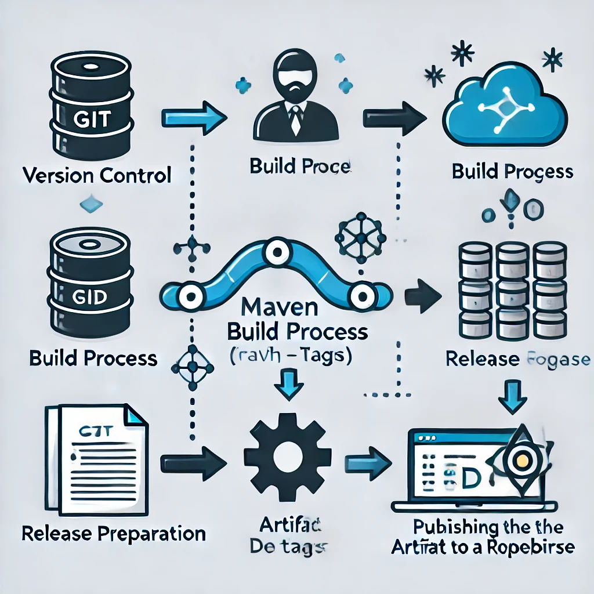

# Общая библиотека ПЭП
Примечание: Инструкция по настройке CI/CD для деплоя в Nexus представлена в разделе "Процесс деплоя с использованием Maven Release Plugin и CI/CD", пункт 5.

📖 **Описание**

Библиотека предоставляет общие инструменты и компоненты, используемые в микросервисах для работы с событиями Kafka, перечислениями и аннотациями.
Она предназначена для унификации подходов и ускорения разработки.

🔧 **Основной функционал**

- Обёртка над Specification (Jakarta Criteria API) для комбинирования пэджинации, фильтрации, сортировки.

1. **Общие перечисления**

Предоставляет набор стандартных enum для различных бизнес-логик.

Примеры:
- Роли
- Перечисления для аудита

2. **События Kafka**

Упрощает интеграцию с Kafka:

- Поддержка стандартных ивентов.

3. **Аннотации**

Предоставляет готовые аннотации для:

- Логирования

# 🚀 Как использовать

**Добавление зависимости**


Добавьте зависимость в ваш проект через Maven.

**Maven**
```xml
<dependency>
<groupId>su.opencode.digsigcik</groupId>
<artifactId>common</artifactId>
<version>1.0.32</version>
</dependency>
```

# 📤 Процесс деплоя с использованием Maven Release Plugin и CI/CD
**1. Подготовка к релизу:**

Команда mvn release:prepare выполняет следующие действия:

- Очистка проекта (clean) и сборка (install).
- Автоматическое обновление версии проекта в pom.xml.
- Создание тега в репозитории SCM (например, Git) с текущей версией проекта.

**2. Тегирование:**

Плагин автоматически создает тег в репозитории SCM (например, Git) с текущей версией проекта.

**3. Публикация артефакта:**

После создания тега команда mvn release:perform:

- Скачивает проект с указанным тегом из репозитория.
- Собирает проект и публикует артефакт в репозиторий Maven (например, Nexus). Этот процесс делает артефакт доступным для других проектов.

**4. Конфигурация:**

Конфигурация плагина в pom.xml включает параметры для аутентификации через git.username и git.token. Эти данные можно
передавать через систему CI/CD (например, Jenkins, GitLab CI и т.д.) для автоматического доступа к репозиторию. В секциях
distributionManagement и scm используются переменные, которые также задаются через окружение. Это позволяет упростить настройку и избежать прямого хранения конфиденциальных данных в pom.xml.
Параметры передаются через конфигурацию CI/CD в виде переменных окружения или секретов.

При использовании Maven Release Plugin необходимо задать следующие переменные окружения:

| Переменная                  | Описание                                                                                   |
|-----------------------------|-------------------------------------------------------------------------------------------|
| `git.scm.url`               | URL репозитория, в котором хранится исходный код проекта.                                  |
| `git.scm.connection`        | SCM соединение для репозитория, например, `scm:git:https://repo.url.git`.                  |
| `git.scm.developerConnection` | Соединение разработчика для работы с репозиторием, например, `scm:git:https://repo.url.git`. |
| `git.username`              | Имя пользователя для аутентификации в SCM репозитории.                                     |
| `git.token`                 | Токен для аутентификации в SCM репозитории.                                               |


**5. Инструкция для настройки CI/CD процесса для размещения библиотеки в Nexus:**

1. Настройка CI/CD

   Адаптируйте процесс CI/CD, используя файл drone.yaml (находящийся в корне проекта), а именно, адаптируйте шаг release-plugin-prepare.
   Этот файл содержит настройки для сборки, тестирования и деплоя в Nexus.

Обратите внимание:

- Для корректной работы ознакомьтесь с используемыми переменными окружения в пункте 3.
- Проверьте, чтобы все необходимые секреты и токены для авторизации были настроены в CI/CD.

2. Обновление файла pom.xml

   В файле pom.xml(находящийся в корне проекта) необходимо указать URL вашего Nexus в секции <distributionManagement> следующим образом:

```xml
<distributionManagement>
<repository>
<id>nexus</id>
<name>Release repository</name>
<url>ВАШ URL (пример: https://nexus.essocode.ru/repository/mvn-ocode/)</url>
</repository>
</distributionManagement>
```
- Замените ВАШ URL на адрес вашего Nexus или аналогичного репозитория.

3. Таблица переменных окружения

### Таблица переменных окружения

| Переменная          | Описание                                   | В pom.xml     | Пример                             |
|---------------------|-------------------------------------------|-------------------------------|-----------------------------------|
| `GIT_USERNAME`      | Имя пользователя для Git                  | `git.username`                | `my_git_user`                     |
| `PAT_TOKEN`         | Личный токен доступа Git                     | `git.token`                   | `ghp_ABC123XYZ456TOKEN`           |
| `NEXUS_USERNAME`    | Имя пользователя для Nexus                | -                             | `nexus_user`                      |
| `NEXUS_PASSWORD`    | Пароль для Nexus                          | -                             | `securePassword123`               |
| `GIT_EMAIL`         | Email для Git                             | -                             | `user@example.com`                |
| `SCM_URL`           | URL репозитория исходного кода            | `git.scm.url`                 | `https://git.essocode.ru/o-code/common.lib.git`    |
| `SCM_CONNECTION`    | URL для подключения к SCM                 | `git.scm.connection`          | `scm:git:https://git.essocode.ru/o-code/common.lib.git`|
| `SCM_DEV_CONNECTION`| URL для подключения разработчиков к SCM   | `git.scm.developerConnection` | `scm:git:https://git.essocode.ru/o-code/common.lib.git`|


4. Автоматический деплой

   После выполнения изменений и настройки пайплайна ваш проект будет автоматически собираться и деплоиться в указанный репозиторий Nexus с помощью плагина Maven Release.



**6. Безопасность:**

Для безопасного деплоя:

- Храните PAT_TOKEN, GIT_USERNAME, SCM_URL, NEXUS_REPO_URL и др. в секциях переменных окружения или секретов CI/CD системы.
- Используйте безопасные соединения (HTTPS/SSH) для доступа к репозиториям.

**Итог:**

Тег, созданный в репозитории, используется как основа для публикации артефакта в Nexus. Пайплайн CI/CD автоматически обрабатывает процесс, используя параметры, указанные в переменных окружения.


# 📦 Требования
- Java: 11 Bellsoft Liberica Full
- Spring Boot: 2.7
